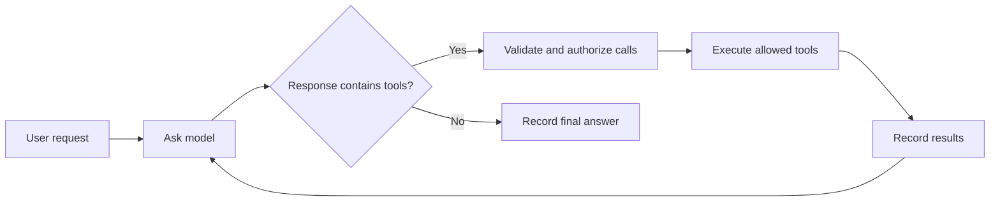

# 1. The whole system

A coding agent is a program that repeatedly asks a language model what to do,
performs permitted actions, and gives the results back to the model. A model
response might contain an answer or a structured request such as “read this
file.” The model itself does not reach into the browser and edit that file.

Suppose you ask: “Fix the broken total in `src/cart.js`.” The agent might read
the file, propose an edit, run a checker, inspect its output, and finally
explain the change. Each model request can use results from earlier steps.

## What runs where?

“Local-first” means the browser owns the project and agent state. It does not
mean a language model runs on your laptop. This design still calls a remote
model API, and any context included in those calls leaves the browser.

| Part | Job | Proposed location |
| --- | --- | --- |
| UI, or user interface | Editor, transcript, approvals, and output | Browser main thread |
| Agent harness | Coordinates model turns and tools | Pi inside QuickJS-Wasm |
| Host/controller | Enforces permissions and manages resources | Agent worker JavaScript |
| Database | Saves conversation, tasks, and project files | SQLite-Wasm backed by OPFS |
| Command runner | Executes a registered formatter or checker | Separate browser worker |
| Model | Generates responses and tool requests | Remote provider |
| Credential relay | Authenticates requests and adds a provider key | Small server in production |

A **harness** is the machinery around the model: scheduling, tool definitions,
conversation history, and recovery. An **adapter** translates one component's
interface into another's. Here, browser adapters connect Pi to host-managed
storage and model transport.

The proposal favors explicit control over desktop compatibility. An ordinary
terminal can launch many installed programs; this application's `run` tool can
launch only commands that the app registers. Imported project files live in a
browser database, so editing them does not automatically edit a local checkout.

## Why so many pieces?

They answer different questions: can the interface keep responding? What may
the agent access? Which work survived a crash? What happens when a tool runs
twice? One technology does not answer all four.

For example, a worker can keep a slow task off the UI thread, but it does not
make that task durable. SQLite can save a tool result, but it does not decide
whether the tool is authorized. Keeping these responsibilities explicit makes
the design easier to reason about.

**Back to the design:** read “Summary,” “Goals,” “Non-goals,” and “System
structure” with this division of responsibilities in mind.

Next: [JavaScript and browser workers](02-javascript-and-workers.md).
