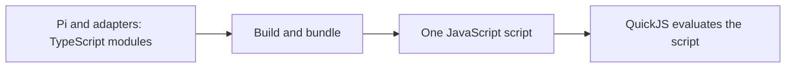
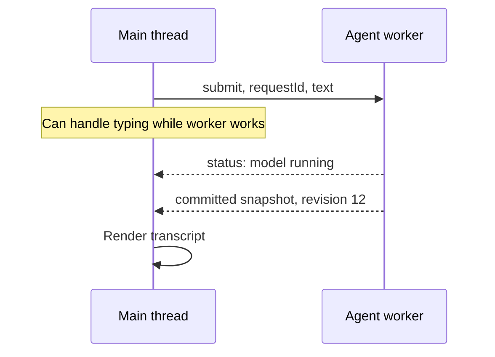

# 2. JavaScript and browser workers

## Language versus runtime

JavaScript is a language. A **runtime** is the environment that executes it and
supplies surrounding facilities. Browser JavaScript can use browser APIs;
Node.js supplies different APIs, such as access to files and child processes.
Sharing a language does not make those facilities interchangeable.

TypeScript adds type descriptions to JavaScript source. A build step removes
those types and produces JavaScript. A **bundler** combines modules and their
dependencies into deployable files. The design needs a self-contained Pi bundle
that does not depend on Node facilities or dynamic imports inside QuickJS.



## The main thread and workers

The browser's main thread runs UI code and participates in rendering. A long
JavaScript calculation can delay typing, scrolling, and painting. A dedicated
**Web Worker** runs JavaScript in a separate execution environment. It cannot
directly modify the page's DOM, the browser's representation of its elements.

The UI and worker exchange messages with `postMessage`. Ordinary data is cloned
using the structured clone algorithm; some resources can instead be transferred.
Neither side receives the other side's ordinary JavaScript objects by reference.



Messages need an agreed format, or **protocol**. A `requestId` matches a reply
to its request. A snapshot revision orders committed views of the project.
These are different identifiers with different jobs.

## Promises, async, and await

A **Promise** represents a result that may arrive later. `await` pauses an async
function until that result is available; it does not turn a computation into a
background thread. A long synchronous loop inside an async function still
blocks the thread running it.

```js
// A language example, not this project's implementation.
async function loadText(url) {
  const response = await fetch(url);
  if (!response.ok) throw new Error("Request failed");
  return await response.text();
}
```

While waiting on network I/O, the runtime can process other work. However,
overlapping async operations can still interfere with each other's state.
The controller therefore queues entries into QuickJS in a **FIFO mailbox**:
first in, first out. The implementation must also handle QuickJS's pending
Promise jobs and Asyncify suspension rules; a queue alone does not solve them.

A worker's lifetime is controlled by the browser. Moving the agent to a worker
does not keep it running after the page closes or the browser suspends it.
A service worker, used later for asset caching, is a different lifecycle
mechanism and is not a permanent agent process either.

**Back to the design:** “UI main thread,” “Runtime controller,” and
“UI-to-worker commands” use these concepts.

Sources: [MDN on workers](https://developer.mozilla.org/en-US/docs/Web/API/Web_Workers_API/Using_web_workers)
and [promises](https://developer.mozilla.org/en-US/docs/Web/JavaScript/Guide/Using_promises).

Next: [WebAssembly and QuickJS](03-webassembly-and-quickjs.md).
