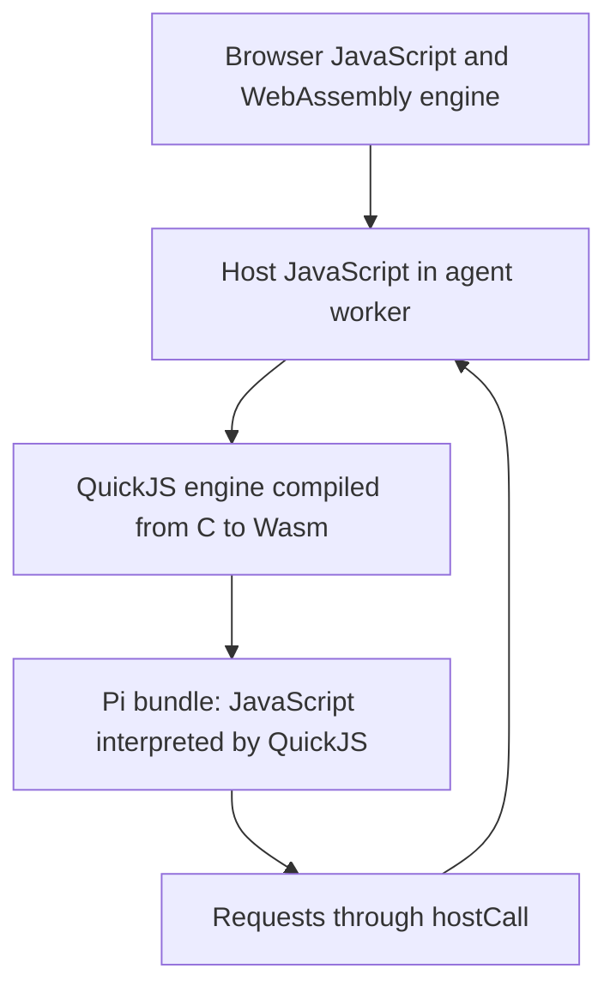
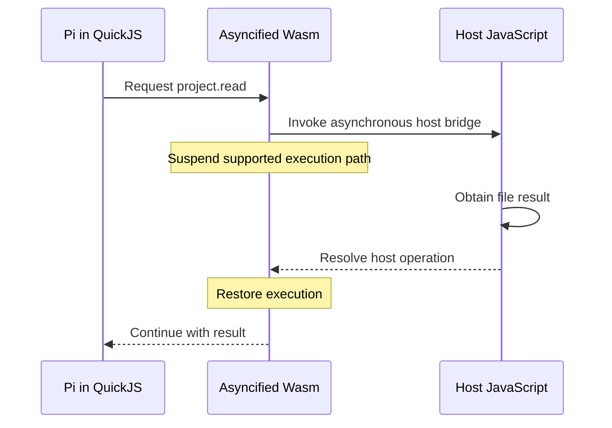

# 3. WebAssembly and QuickJS

## What WebAssembly is

WebAssembly, usually shortened to **Wasm**, is a portable instruction format.
A compiler can translate a program written in a language such as C or Rust into
a `.wasm` file. A compatible runtime loads and executes it.

A **module** describes code and required interfaces. An **instance** is a live
execution of that module with its state. **Linear memory** is a byte-addressed
buffer used by the program. **Imports** are facilities supplied by the host;
**exports** are facilities exposed to the host.

Wasm does not supply a desktop operating system. File access or networking
requires an interface provided by its host. The host must choose those
interfaces carefully: an unrestricted imported function can grant unrestricted
power despite the Wasm boundary.

## Why execute JavaScript inside Wasm?

QuickJS is a JavaScript engine written in C. `quickjs-emscripten` packages a
Wasm build of that engine and JavaScript bindings for controlling it.
**Emscripten** is the toolchain used to compile C/C++ code for this environment.

The proposal does not compile Pi's TypeScript directly into Wasm instructions.
It compiles QuickJS to Wasm, then asks QuickJS to execute Pi's bundled JavaScript.

The host and guest are separate JavaScript environments. Host browser APIs do
not automatically become guest globals. The controller exposes `hostCall` as
the guest's authority interface and must control everything accessible through it.
QuickJS still needs its own limits and careful resource cleanup.

The cost is extra loading, memory, interpretation, and data conversion.
Running JavaScript inside QuickJS-Wasm is not automatically faster than running
the same JavaScript directly in the browser.

## Asyncify: letting Wasm wait

Many browser operations finish asynchronously. An ordinary synchronous Wasm
call cannot simply wait for an unresolved JavaScript Promise.
**Asyncify** transforms compiled code so its execution stack can be suspended
and restored around supported asynchronous host operations. It adds overhead.

QuickJS also has JavaScript Promise handling of its own. Asyncify and guest
Promises solve related but distinct problems; using an async Wasm build does
not automatically wire up Pi's scheduler. The bridge must drive pending guest
jobs and avoid unsupported overlapping or nested entry into a suspended VM.

This is why the design calls for an early compatibility prototype. Pi's
dependencies and database transaction callbacks may not fit these constraints
without adaptation. The exact QuickJS variant and bridge API remain to be
chosen and pinned.

**Back to the design:** AD-1 and the first two “Open questions” are the key
sections. This engine nesting is a requirement of the proposal, not something
every browser agent needs.

Sources: [Wasm concepts](https://developer.mozilla.org/en-US/docs/WebAssembly/Guides/Concepts),
[quickjs-emscripten](https://github.com/justjake/quickjs-emscripten), and
[Emscripten Asyncify](https://emscripten.org/docs/porting/asyncify.html).

Next: [Host calls and capabilities](04-host-calls-and-capabilities.md).
