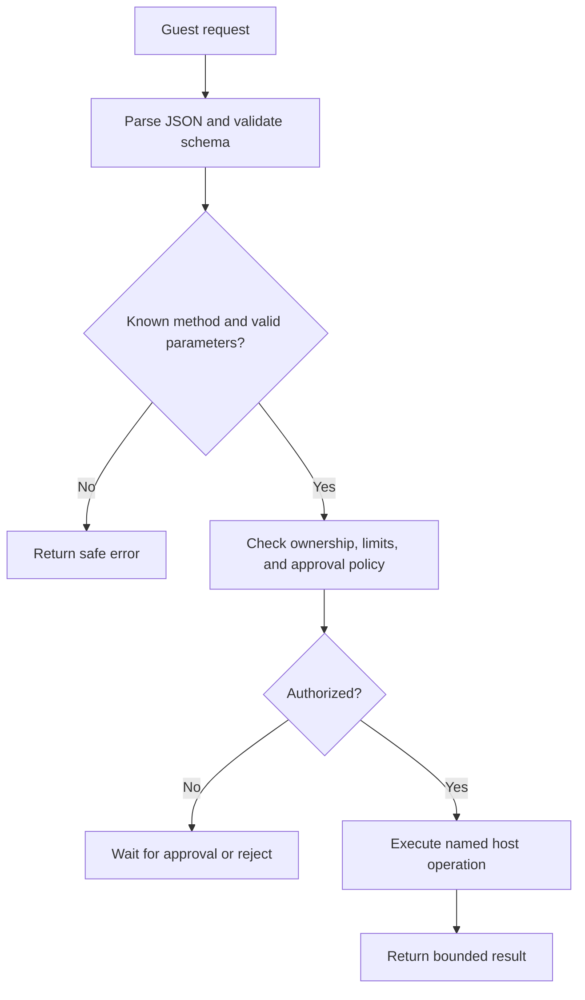

# 4. Host calls and capabilities

A **host** supplies an execution environment. A **guest** runs inside it.
Here, worker JavaScript hosts QuickJS, and the Pi bundle is the guest.

A **capability** is a particular authority made available to code. The ability
to read the active project's files is narrower than the ability to open any
file or send any network request. The controller offers specific operations,
such as `project.read`, instead of exposing all browser APIs.

## One door, many checked operations

The design gives QuickJS one host function:

```ts
declare function hostCall(requestJson: string): Promise<string>;
```

JSON is a text representation of objects, arrays, strings, numbers, booleans,
and null. It is used here to cross the host/guest boundary without sharing live
JavaScript objects. Files containing arbitrary bytes need a separate encoding
convention; functions and native handles cannot simply be JSON-encoded.

An illustrative request, using the design's envelope:

```json
{
  "version": 1,
  "callId": "bridge-call-17",
  "method": "project.read",
  "params": { "path": "src/cart.js" }
}
```

The host parses it, checks its protocol version and method-specific schema,
checks project ownership and limits, and dispatches it through a fixed table.
It returns a JSON success value or a sanitized error. Parsing JSON successfully
does not establish that a request is valid or authorized.



## Types are not runtime validation

A TypeScript interface helps programmers at build time. It does not prevent an
incoming message from containing a negative timeout, a huge payload, or a path
like `../../secrets`. A runtime schema validates actual incoming values.
Path validation and authorization require additional checks.

Never dispatch with arbitrary property access such as
`someHostObject[request.method](request.params)`. A fixed method table keeps
available authority reviewable. Likewise, SQL access intended for a storage
adapter must actually be confined; a `pi_` table prefix alone is not an access
control mechanism. The design's namespace restriction needs enforcement in the
implementation.

## Keep identifiers separate

| Identifier | Purpose |
| --- | --- |
| UI `requestId` | Match and deduplicate a user command. |
| Bridge `callId` | Identify a host-protocol call. |
| Stable tool operation ID | Find the same effect after crash recovery. |
| Project/file revision | Detect changes since data was read. |

A new bridge invocation during recovery must still carry the same stable tool
operation ID for the effect being retried. The proposal leaves some concrete
parameter schemas unspecified; implementation must define where that ID lives.

**Back to the design:** AD-6, “QuickJS host capabilities,” “Project service,”
and “Approval model.” Credentials are another example: the guest receives a
model configuration identifier, and the host attaches the actual secret.

Next: [SQLite, OPFS, and project files](05-storage-and-project-files.md).
