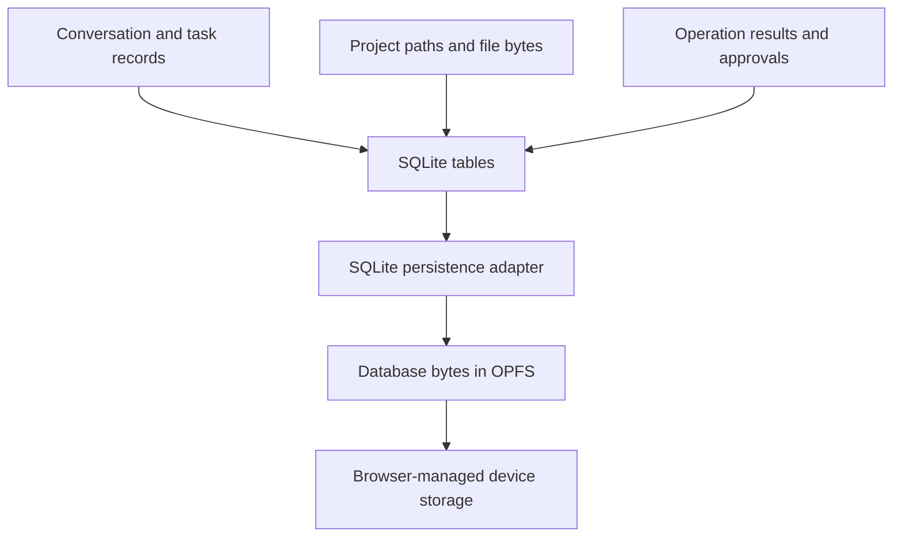

# 5. SQLite, OPFS, and project files

## Storage has layers

SQLite is an embedded database engine: it runs inside the application rather
than as a separate database server. SQL is its language for reading and changing
tables. A row represents one record; a primary key uniquely identifies it.
A BLOB stores bytes, such as a file's content.

SQLite-Wasm is SQLite compiled for a WebAssembly environment. It still needs
somewhere to persist its database bytes. **OPFS**, the origin private file
system, provides browser-managed file storage scoped to the application's
origin. An origin is the combination of scheme, hostname, and port.



The persistence adapter is often called a **VFS**, or virtual filesystem layer.
SQLite's OPFS options have different worker and browser requirements. Some
configurations require shared memory and cross-origin isolation; the selected
adapter must be tested rather than assuming all OPFS setups work alike.

## Why store project files as database rows?

In this design, `src/cart.js` is a key in `app_file`, with content and revision
columns. It is not a separate canonical file beside the database in OPFS.
This lets one database transaction update file content and record the edit's
operation result together.

A **transaction** groups changes into one commit. If an error occurs before
commit, rollback discards the transaction's changes. The application must also
use a persistence configuration that delivers the required crash behavior.

Conceptually, an edit does this:

```sql
-- Teaching sketch: host code must also check affected rows and conflicts.
BEGIN;
UPDATE app_file
SET content = ?, revision = revision + 1
WHERE project_id = ? AND path = ? AND revision = ?;
-- Record the effect result and advance the project revision here too.
COMMIT;
```

The `?` placeholders are **bindings**, values supplied separately from SQL
text. They avoid building SQL by interpolating untrusted text.

## Revisions prevent stale edits

Suppose the agent reads file revision 7. You then change the file to revision
8. Its edit must say “apply only if this is still revision 7.” The host detects
the mismatch, applies nothing, and asks the agent to work from fresh content.
This is **optimistic concurrency control**.

An argument hash identifies the requested operation's content; a revision
identifies the version being edited. Neither replaces the other. Path rules
also matter: rejecting absolute paths and `..` prevents a project-relative name
from being interpreted as an escape into another location.

## Persistence is not a backup

Browser storage has quotas and may be evicted depending on browser policy and
storage permissions. Requesting persistent storage reduces some eviction risk;
it cannot prevent deliberate clearing of site data. The design's durability
goals must be read alongside that browser limitation.

Exports need a consistent database snapshot, version manifest, and integrity
hashes. Copying a live database file carelessly can produce an unusable backup.
Import should validate into a new project, preserving the old one. A **schema
migration** changes table structure or stored data for a new application version.

**Back to the design:** AD-3, “SQLite host,” “Data model,” and “Storage, backup,
and migration.”

Sources: [SQLite transactions](https://www.sqlite.org/transactional.html),
[SQLite-Wasm persistence](https://www.sqlite.org/wasm/doc/trunk/persistence.md),
and [OPFS](https://developer.mozilla.org/en-US/docs/Web/API/File_System_API/Origin_private_file_system).

Next: [Agents, checkpoints, and crash recovery](06-durable-agents-and-recovery.md).
