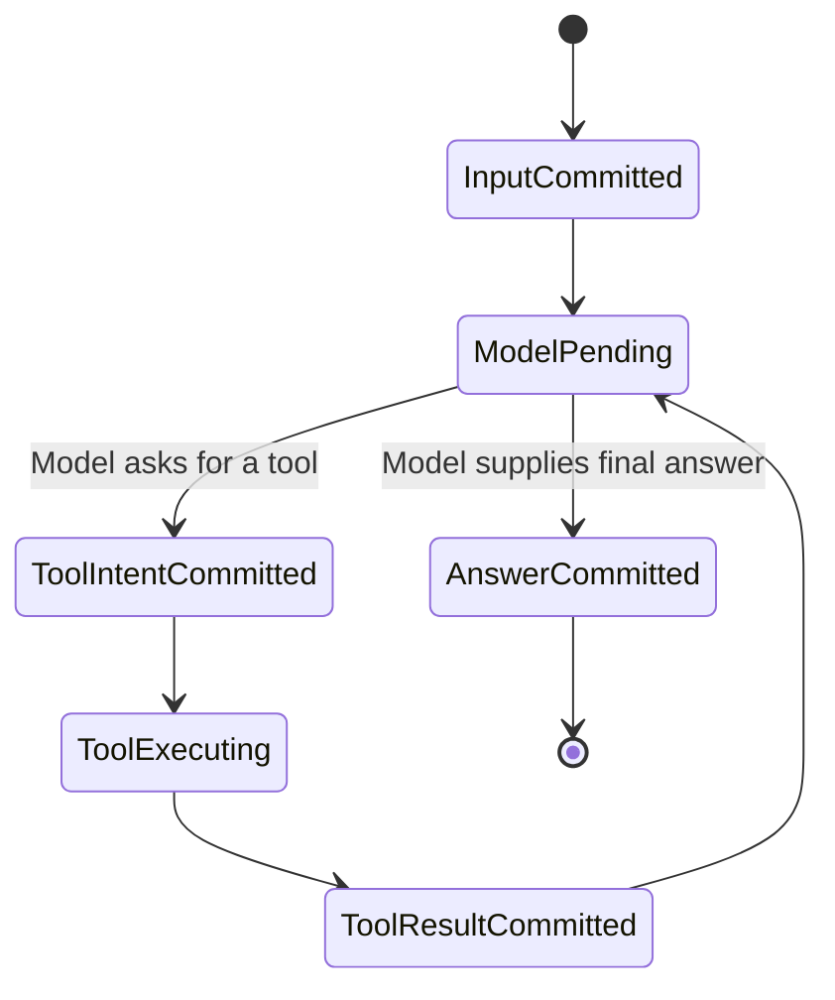
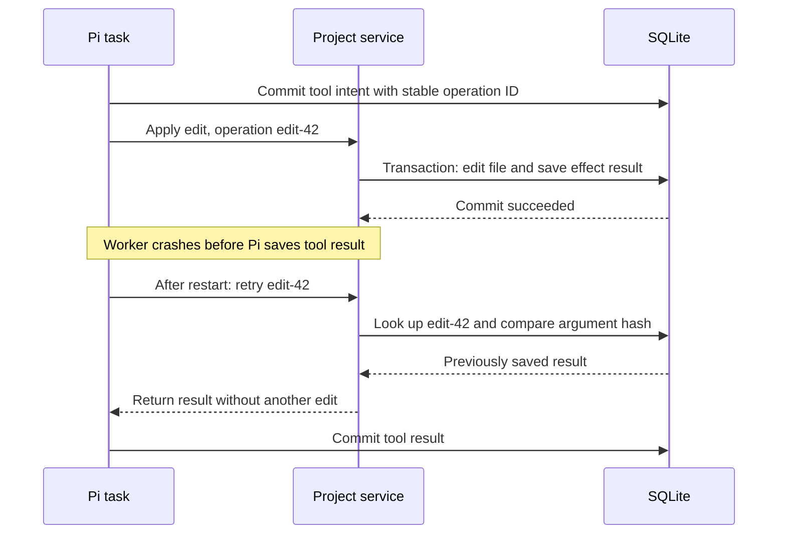

# 6. Agents, checkpoints, and crash recovery

## Pi's job

`pi-durable` is the proposed agent harness. Its transcript consists of immutable
entries, and its model and tool work runs as tasks that save checkpoints.
A **checkpoint** records enough task state to continue work after reopening
storage. An adapter connects Pi's storage interface to the host's SQLite bridge.

A **state machine** describes named states and the transitions between them.
An agent task might move from waiting for a model, to running tools, to waiting
for another model response, to complete. Durable task state is saved data;
ordinary JavaScript variables disappear with the worker.

This diagram explains the flow, not Pi's literal internal state names. A
checkpoint does not freeze a network connection or the CPU stack. Recovery
reconstructs work from stored records and may repeat an interrupted phase.
Pi's tool replay policy must explicitly mark a tool safe before relying on
automatic re-execution.

## The dangerous gap: effect succeeded, result missing

Imagine an edit that appends a line. SQLite commits the file change, then the
worker crashes before Pi commits the tool result. Pi sees unfinished work on
restart. Blindly rerunning the edit would append the line twice.

The host's **effect ledger**, `app_effect`, closes this gap. It stores the
stable operation ID, argument hash, and result in the same transaction as the
file change. Retrying the same ID and arguments returns the saved result.

## Idempotency has a scope

An operation is **idempotent** when repeating it has the same effect as doing
it once. Setting a value to `true` is naturally idempotent; appending text is
not. The ledger makes the latter replay-safe for a particular operation ID.
Reusing that ID with changed arguments must fail.

This gives at most one committed local project effect per stable operation ID,
provided checks and writes are in the same correctly serialized transaction.
It does not mean the tool's code executes only once.

A remote model call is outside that transaction. If the provider answers but
the response is not committed locally, recovery may call it again and incur
another charge. A provider-specific idempotency facility can help when
available; it cannot be assumed universally.

The UI also participates in reliability: it renders committed transcript
snapshots. A “running” indicator is temporary status, not proof that a result
was saved. On reconnect, a fresh snapshot replaces any missed events.

**Back to the design:** AD-4, “File edit tool,” and “Crash recovery.” The
effect ledger complements Pi checkpoints; both are necessary.

Source for the harness concepts and replay policy:
[Pi durable documentation](https://github.com/earendil-works/pi/blob/main/packages/durable/README.md).
The ledger protocol above is this project's proposed application design.

Next: [Model requests and streaming](07-model-transport-and-streaming.md).
