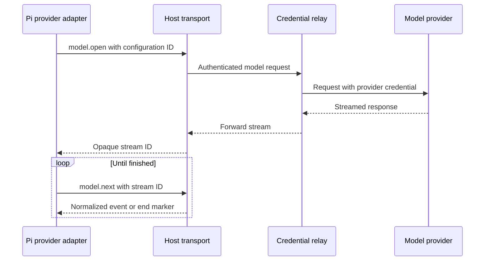

# 7. Model requests and streaming

## HTTP and APIs

An **API** is an agreed interface between programs. A model provider usually
exposes an HTTP API: the client sends a request to a URL, and the server returns
a response. A request includes a method, headers, and often a JSON body.
Credentials in headers authorize access and may incur charges.

“OpenAI-compatible” describes a family of API conventions. It does not
guarantee that every provider implements identical tool events, errors,
cancellation, or usage reporting. The provider adapter must normalize the
selected endpoint's behavior for Pi.

## Streaming means incremental delivery

A streamed response arrives over time instead of waiting for the complete
answer. Some endpoints use **SSE**, server-sent events: text records separated
by blank lines, often carrying JSON in `data:` fields. A POST-based model
request can read that format using `fetch`; it need not use the browser's
`EventSource` interface.

A network chunk is not necessarily one event. It may end halfway through a
record or a multibyte character. The transport needs incremental text decoding,
framing, and parsing. Tool-call arguments may also arrive in fragments and must
be assembled and validated before execution.

The sketch shows logical ownership; the host may return the stream ID before
provider events arrive. “Normalized” means converting provider-specific records
to the event format the adapter expects. Pulling events through `model.next`
supports demand-driven consumption, but the host must still bound its buffers
and apply **backpressure**, slowing upstream consumption when downstream work
cannot keep up.

## Why use a credential relay?

The production relay is a small server that authenticates the browser, applies
quotas, and attaches a provider key. It forwards traffic but, by design, stores
no project or conversation state. It still sees the request contents in transit
and must be operated accordingly. A relay is not a privacy shield from the model
provider.

Keeping a key out of QuickJS limits guest access. Keeping a production provider
key on the server also prevents shipping that key to every browser. Development
BYOK, “bring your own key,” keeps a supplied key only in host memory. Direct
browser requests additionally require provider support for browser access,
including applicable CORS rules.

## Cancellation and uncertainty

An abort controller lets the host request cancellation of fetch work. Aborting
locally does not prove the provider stopped generating or charging. The relay
must propagate disconnects, and the UI must distinguish cancelled local work
from a confirmed provider outcome.

A partial stream is not a complete assistant answer. Pi's commit rules decide
what becomes durable; the UI renders committed transcript state. Disconnects
can lead to retries, with the cost uncertainty explained in the recovery chapter.

**Back to the design:** AD-6, “Model streaming,” and “User submission and model
turn.”

Source for SSE framing:
[MDN: Using server-sent events](https://developer.mozilla.org/en-US/docs/Web/API/Server-sent_events/Using_server-sent_events).
The host bridge and relay behavior are this project's proposed protocol.

Next: [WASI and command execution](08-wasi-and-command-execution.md).
