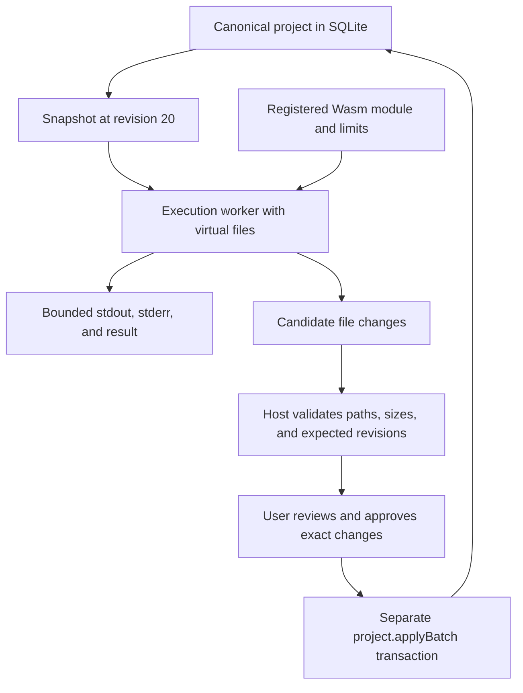

# 8. WASI and command execution

## Wasm needs an environment

A compiled command often expects to read files, obtain arguments, and write
output. Wasm instructions alone do not supply those facilities. **WASI**, the
WebAssembly System Interface, defines interfaces that a host can implement for
Wasm programs. Different WASI versions and interface sets are not automatically
interchangeable.

The browser does not automatically provide a complete WASI environment. A
runner supplies compatible imports, memory-backed files, output handling, and
other supported facilities. A module expecting unsupported interfaces cannot
run merely because its filename ends in `.wasm`.

**POSIX** is a family of operating-system interface standards. Implementing a
useful subset of WASI does not create a POSIX or Linux machine. Arbitrary Node
packages, native executables, and package install scripts remain outside the
proposal's compatibility scope.

## A command registry replaces the shell

The proposed agent submits structured requests like this illustrative one:

```json
{
  "command": "format-js",
  "args": ["src/cart.js"],
  "cwd": ".",
  "timeoutMs": 5000
}
```

`format-js` is an example registry name, not a selected implementation.
The host resolves the name to a pinned module, validates arguments, and applies
limits. A working directory identifies the command's starting location in its
virtual filesystem; the host defines and validates that mapping.

There is no shell to interpret `|`, `>`, or `$(...)`. Such text is either a
literal argument or rejected. Argument validation is still necessary: an
individual program may interpret flags that expand its authority or workload.

## Snapshot, execute, propose, commit



The command's files are a disposable copy. The default project mount is
read-only, while `/tmp` is writable. A command allowed to propose edits needs a
controlled writable copy or output area from which a delta can be computed.
It never receives direct write access to canonical database files.

**Preopened directories** are directory handles deliberately supplied by the
runner. They are part of the command's permitted view of files. Network access
must likewise be withheld by not providing interfaces that grant it.

## Limits need actual enforcement

Standard output, or **stdout**, carries ordinary command output. Standard
error, or **stderr**, carries diagnostic output. Both need byte limits so a
misbehaving command cannot exhaust memory by printing forever.

A wall-clock timeout bounds elapsed time; a memory ceiling bounds allocation.
**Fuel** counts execution work when a runtime supports metering. The browser's
standard Wasm API does not provide a universal fuel switch, so the chosen runner
must demonstrate any promised instruction or CPU budget. Terminating a separate
worker provides a practical way to stop a synchronous infinite loop from outside
that worker. A timer inside the blocked worker would not suffice.

If the command dies, the project remains at its committed revision. A formatter's
proposed changes can conflict with edits made since its snapshot; approval must
not bypass revision checks.

**Back to the design:** AD-5, “Execution workers,” and “Command execution.”

Source for WASI's scope: [WASI introduction](https://wasi.dev/).
The registry and snapshot protocol are proposed application behavior.

Next: [Security and deployment](09-security-and-deployment.md).
