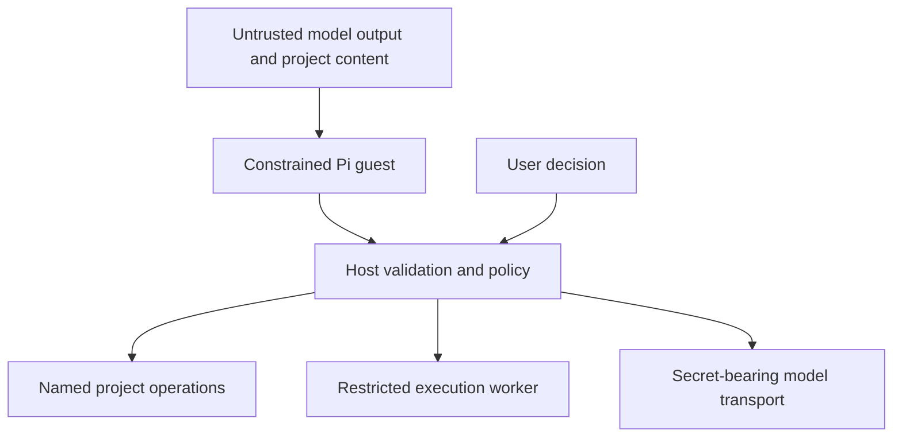

# 9. Security and deployment

## Trust follows authority

Project text can contain instructions that attempt to manipulate the model.
This is often called **prompt injection**. A sentence in a source file cannot
be allowed to grant filesystem or network access. The host enforces permissions
on every request, regardless of why the model requested it.



The host is trusted because it holds real authority. A bug in its router or
project service can defeat guest isolation. Wasm memory isolation, worker
separation, input validation, and approvals address different failure modes.

Approvals bind an exact operation ID, arguments, and relevant project revision.
If those change, approval becomes stale. Deletion, renaming, large batches, and
command-produced edits require approval under the proposal. Displaying a modal
without enforcing the decision in the host would not create a permission boundary.

## One project writer across tabs

Two tabs can open the same origin's storage. The design uses an exclusive
**Web Lock**, named for the project, to select one writer. Other tabs observe
sanitized state through `BroadcastChannel`, a browser messaging API.

```mermaid
sequenceDiagram
    participant A as Tab A worker
    participant Lock as Project Web Lock
    participant B as Tab B worker
    A->>Lock: Acquire exclusive ownership
    Lock-->>A: Granted
    B->>Lock: Try to acquire ownership
    Lock-->>B: Unavailable while A owns it
    A-->>B: Broadcast sanitized snapshots
    Note over A,B: B observes; takeover requires A to release ownership
```

Broadcast messages are notifications, not a substitute for ownership. Web Locks
are cooperative: every legitimate writer must follow the protocol. They are not
a security barrier against arbitrary compromised JavaScript on the same origin.
Lock support alone also does not prove that a SQLite persistence adapter allows
the desired observer behavior; the design avoids writable observer connections.

## Browser policies and server headers

Deployment includes configuration of the server that delivers the application.
These policies cannot be established merely by displaying settings in the UI.

| Term | Meaning here |
| --- | --- |
| HTTPS | Encrypts traffic and enables secure-context browser features. |
| CSP | Content Security Policy restricts which scripts, workers, and connections the page may use. |
| COOP | Cross-Origin-Opener-Policy controls relationships with other browsing contexts. |
| COEP | Cross-Origin-Embedder-Policy controls loading of cross-origin resources. |
| Cross-origin isolation | Browser state enabled by appropriate policies, needed for features such as shared memory. |
| CORS | A server's rules for allowing browser code from another origin to read responses. |

COOP and COEP are distinct from CORS. The proposed headers support isolation;
their actual effect depends on the selected SQLite/Wasm configuration and all
loaded assets. Check `crossOriginIsolated` and feature availability in real
deployed browsers. CSP must also permit the chosen engine's Wasm compilation
path: where required, a narrowly scoped `wasm-unsafe-eval` policy needs evaluation
rather than assuming the design's example policy is sufficient unchanged.

## Releases, backups, and privacy

A cryptographic integrity hash fingerprints module bytes. Verifying against a
trusted expected hash detects different bytes; it does not prove that the code
is safe or correctly licensed. Pinning dependency versions and their integrity
values makes a build more reproducible.

The proposed service worker caches versioned application assets. It does not
keep the agent alive indefinitely, and upgrades need coordination so old worker
code is not mixed with incompatible new bundles or schema migrations.

Treat imports as hostile: validate paths, file counts, expanded sizes, and
compression ratios. A small compressed archive can expand to an enormous size,
an **archive bomb**. Render model and tool output as text to avoid interpreting
it as executable page content. Keep keys and content out of diagnostics.

Finally, local-first persistence does not remove the need for exports. Test
restore in a fresh browser profile: seeing an export download is not proof that
it contains a usable project.

**Back to the design:** AD-2, “Approval model,” “Security model,” “Deployment,”
and “Observability.” Header requirements and storage support need validation.

Sources: [Web Locks](https://developer.mozilla.org/en-US/docs/Web/API/Web_Locks_API),
[CSP](https://developer.mozilla.org/en-US/docs/Web/Security/Practical_implementation_guides/CSP),
[`script-src` and Wasm compilation](https://developer.mozilla.org/en-US/docs/Web/HTTP/Reference/Headers/Content-Security-Policy/script-src),
and [cross-origin isolation](https://developer.mozilla.org/en-US/docs/Web/API/Window/crossOriginIsolated).

Next: [From concepts to a prototype](10-building-and-verifying.md).
