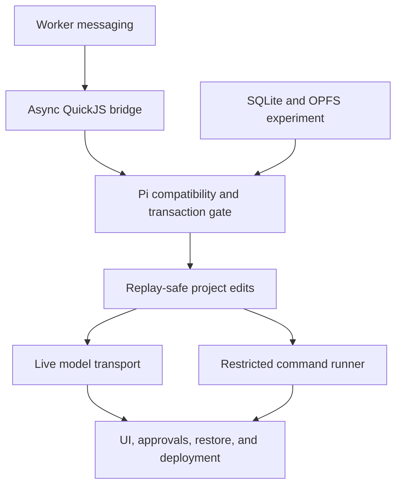

# 10. From concepts to a prototype

Reading the design should now feel less like encountering a wall of product
names. The practical next step is to prove its difficult boundaries before
building the full editor and chat interface. This chapter is a learning and
implementation sequence, not a claim that these pieces already exist.

## Build small experiments with visible outcomes

1. **Worker round trip.** A page sends a message to a module worker and renders
   the reply. Add a request ID, runtime validation, and an invalid-message case.
   You have learned the UI/runtime boundary when the page stays responsive and
   reports malformed messages clearly.
2. **QuickJS host round trip.** Load a pinned asyncified QuickJS build in the
   worker, run a tiny guest script, and bridge a delayed host result. Exercise
   guest Promises, pending jobs, errors, cancellation, and cleanup. Do not assume
   that one successful synchronous evaluation proves async support.
3. **Persistent SQLite.** Choose an OPFS adapter, create a small table, reload,
   and read it back. Test rollback and quota failures, then verify the deployment
   headers in each intended browser engine.
4. **Pi integration gate.** Bundle Pi without Node adapters. Connect its storage
   adapter and a deterministic fake model. Persist a prompt, perform a tool
   round trip, restart, and resume. Specifically test transaction callbacks
   across the asyncified bridge for nested-entry problems.
5. **Replay-safe edits.** Add canonical project rows, expected revisions, and
   the effect ledger in one transaction. Kill the worker after the edit commits
   but before Pi records the result. Verify recovery produces one edit.
6. **Live model transport.** Add stream parsing, configuration IDs, bounded
   buffering, and abort propagation. Test fragments and disconnects before
   depending on a live model for normal development.
7. **One restricted command.** Choose a formatter or checker with compatible
   Wasm/WASI interfaces. Feed it a snapshot, enforce output/time/memory limits,
   and require approval before committing any proposed delta.
8. **Product lifecycle.** Add observer tabs, takeover, reviewed diffs, exports,
   restore, migrations, safe updates, and usable failure messages.

If Pi cannot run correctly inside the chosen QuickJS build, or its storage
callbacks cannot cross the bridge safely, revisit the architecture explicitly.
Running Pi directly in worker JavaScript is a useful diagnostic comparison, but
it does not validate the design's Pi-inside-Wasm requirement.

## Test invariants, not just happy paths

An **invariant** is a property that must remain true across operations and
failures. These are concrete checks derived from the proposed design:

| Experiment | Required observation |
| --- | --- |
| Retry one edit ID with identical arguments | One committed file effect; saved result returned. |
| Retry that ID with changed arguments | Protocol error; no additional mutation. |
| Edit using a stale file revision | No partial changes; conflict reported. |
| Crash before transaction commit | No portion of the transaction survives. |
| Crash after file/effect commit, before Pi result commit | Recovery finds the saved effect. |
| Open two tabs on one project | At most one writer; observer receives sanitized state. |
| Run an infinite loop or unbounded printer | Worker terminates or output is capped; UI responds. |
| Disconnect midway through a model event | Parser handles incomplete data; no invented complete answer. |
| Import an archive with `../` entries | Import fails without altering an existing project. |
| Restore an export in a fresh profile | Conversation, project files, and resumable state are recoverable. |

A deterministic fake model returns scripted responses and tool requests. It
makes a crash test repeatable and avoids model charges. A small opt-in live
provider suite checks compatibility separately. Storage conformance tests check
that the browser adapter preserves Pi's expected transaction behavior.

## Choices the design deliberately leaves open

No exact package versions, command modules, browser version floor, UI framework,
or complete bridge parameter schemas are selected in the proposal. The method
lists are also not one finished API: for example, the host capability envelope
does not yet enumerate every project-service operation discussed elsewhere.
Resolve these details in the prototype rather than inventing compatibility
guarantees in documentation.

The design's startup and memory budgets are targets to measure. Record bundle
sizes, startup timings, queue depth, and memory use without capturing user
content. Separate an unsupported browser feature from a bug and show that
distinction in the UI.

**Back to the design:** “Verification,” “Performance constraints,” “Failure
handling,” and “Open questions” become the implementation acceptance criteria.

Keep the [glossary](glossary.md) open while rereading the
[full design](../projects/web-coding-agent/DESIGN.md).
