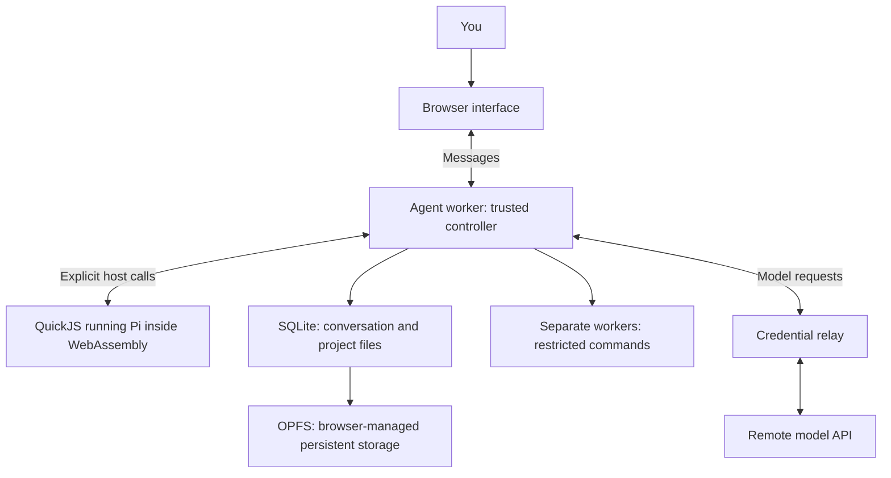

# Technical foundations for the Web Coding Agent

This guide assumes no knowledge of WebAssembly, browser workers, or durable
agents. It explains what each part does, why the proposed agent needs it, and
how the parts fit together. You do not need to learn to write WebAssembly by
hand to build this application.

The [technical design](../DESIGN.md) describes a
**proposed architecture**, not an implemented application. These chapters teach
that architecture; their examples are illustrative, not a working SDK or a
promise that the integrations already work. Upstream documentation was checked
on 2026-10-20. Package APIs and browser support must be checked again when
choosing actual versions.

## Read in this order

| Chapter | What you will understand |
| --- | --- |
| [1. The whole system](01-the-whole-system.md) | What runs locally, what runs remotely, and what an agent actually is. |
| [2. JavaScript and browser workers](02-javascript-and-workers.md) | Runtimes, TypeScript, promises, messages, and keeping the UI responsive. |
| [3. WebAssembly and QuickJS](03-webassembly-and-quickjs.md) | Why a JavaScript engine runs inside another engine, and what Asyncify solves. |
| [4. Host calls and capabilities](04-host-calls-and-capabilities.md) | How isolated code requests useful work without getting unrestricted access. |
| [5. SQLite, OPFS, and project files](05-storage-and-project-files.md) | Where the project lives and what transactions protect. |
| [6. Agents, checkpoints, and crash recovery](06-durable-agents-and-recovery.md) | The agent loop, Pi's role, and why retries need an effect ledger. |
| [7. Model requests and streaming](07-model-transport-and-streaming.md) | HTTP, streamed events, credentials, relays, and cancellation. |
| [8. WASI and command execution](08-wasi-and-command-execution.md) | How a formatter or checker runs without a Linux machine. |
| [9. Security and deployment](09-security-and-deployment.md) | Browser origins, approvals, headers, backups, and multiple tabs. |
| [10. From concepts to a prototype](10-building-and-verifying.md) | A build order, design-validation gates, and meaningful failure tests. |
| [Glossary](glossary.md) | Plain-language definitions to use while rereading the design. |

## The picture to keep in mind

The model suggests actions. Pi organizes the work. The host decides which
actions are allowed and carries them out. SQLite remembers committed progress.
The UI displays that progress. The relay is the production credential path in
the proposal; a development mode can contact a compatible provider directly.

Every chapter includes a connection back to the design and further reading.
Mermaid blocks render as diagrams in viewers with Mermaid support, including
GitHub; a plain Markdown viewer may show their source instead.
